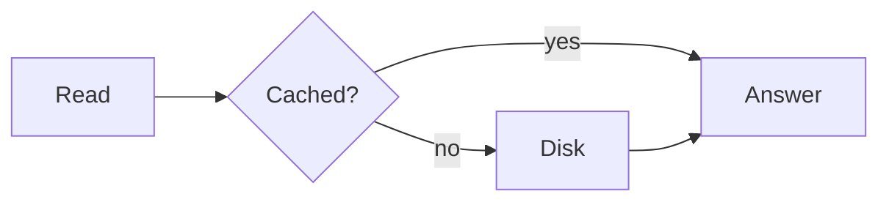

<p align="center">
  
</p>

<h1 align="center">Math and Diagrams</h1>

<p align="center">
  TeX math and Mermaid diagrams in your Kite posts, written in plain Markdown.
</p>

<p align="center">
  <a href="https://github.com/kite-plus/plugin-math/actions/workflows/ci.yml"></a>
  <a href="https://github.com/kite-plus/plugin-math/releases/latest"></a>
  <a href="https://github.com/kite-plus/kite"></a>
  
  <a href="LICENSE"></a>
</p>

<p align="center">
  English · <a href="README.zh-CN.md">简体中文</a>
</p>

<p align="center">
  
</p>

Math and Diagrams is an official plugin for
[Kite](https://github.com/kite-plus/kite). It typesets TeX with
[KaTeX](https://katex.org) and draws `mermaid` code blocks with
[Mermaid](https://mermaid.js.org), right where you wrote them.

<p>
  
  
</p>

## Features

- **Math the way you already write it.** `$…$`, `$$…$$`, `\(…\)`, `\[…\]` and
  `math` code blocks.
- **Markdown keeps its hands off your TeX.** Before a page is rendered, the
  plugin's module shields the math from Markdown, so `\\`, `_` and `*` arrive
  exactly as written.
- **Prices stay prices.** `$5 and $10` is not mistaken for math, and code
  spans and code blocks are never touched.
- **Diagrams from text.** A `mermaid` code block becomes a flowchart, a
  sequence diagram, a Gantt chart or anything else Mermaid draws, and is
  drawn again when the page turns dark or light.
- **Only where it is needed.** KaTeX and Mermaid are loaded on the pages that
  have math or a diagram, from jsDelivr, unpkg or npmmirror.

## Writing

````markdown
Inline, $e^{i\pi} + 1 = 0$ or \(x_i\).

$$
\begin{aligned}
\bar{t} &= h \, t_h + (1 - h) \, t_m \\
        &= t_m - h \, (t_m - t_h)
\end{aligned}
$$


````

Inline math opens with a `$` that has no space after it, and closes with a
`$` that has no space before it and no digit after it, which is what keeps
prices out.

## Install

1. Download `math-<version>.zip` from the
   [latest release](https://github.com/kite-plus/plugin-math/releases/latest).
2. In Kite's studio, open **Plugins**, drop the zip on **Upload plugin**, and
   switch it on.

Or from the command line, inside your site:

```sh
kite plugin add math-0.1.0.zip
kite plugin enable math
```

It needs Kite 0.1 or later.

## Settings

| Setting | Default | What it does |
|---|---|---|
| Math | On | Typesets TeX between `$` and `$`, `$$` and `$$`, `\(` and `\)`, `\[` and `\]`, and in `math` code blocks |
| Diagrams | On | Draws `mermaid` code blocks as diagrams |
| Load scripts from | jsDelivr | jsDelivr, unpkg or npmmirror, which is the quicker one from mainland China |

## How it works

Markdown reads TeX as Markdown: `\\` turns into `\`, and a pair of `*` or `_`
turns into emphasis. So before a page is rendered, the plugin's module,
`plugin.wasm`, turns display math into a `math` code block, which Markdown
leaves alone, and escapes the punctuation in inline math, between `\(` and
`\)`. In the reader's browser, `math.js` typesets both and draws the
diagrams. The module runs in Kite's sandbox: no network and no files, only
the page it is handed.

## Development

The module is Go, built for WebAssembly with Go 1.24 or later.

```sh
make test     # the rewriting, on this computer
make build    # plugin.wasm
kite plugin verify .
```

To try it on a site, `kite plugin add /path/to/plugin-math` copies this folder
in, module included.

## Releasing

Set `version` in `plugin.yaml`, commit, and push a tag of the same version,
such as `v0.1.0`. The release workflow tests and builds the module, packs
`dist/math-<version>.zip` without the module's source, and attaches it to a
GitHub release. `make zip` packs the same file locally.

## More official plugins

| Plugin | What it adds |
|---|---|
| [Analytics](https://github.com/kite-plus/plugin-analytics) | Visit counts with Baidu Tongji, Google Analytics, Umami or Plausible |
| [Comments](https://github.com/kite-plus/plugin-comments) | A comment thread under every post, with Giscus, Waline or Twikoo |
| [Search](https://github.com/kite-plus/plugin-search) | Search in the reader's browser, with nothing to run |

## License

[Apache License 2.0](LICENSE).
